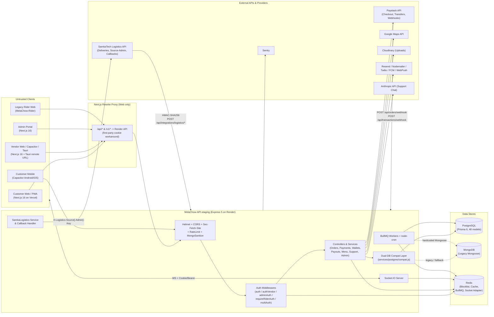

 Phase 1: Architecture & System Orientation

**Target system:** MelaChow — a Nigerian multi-vendor food delivery platform (live with real users, Paystack payments, wallets/payouts, and customer PII subject to NDPR).
**Confirmed deployment split (user-verified):**
- **Live Production:** runs **MongoDB** + **in-house MelaChow rider logistics** (`MelaChow-Rider`).
- **Staging (`MelaChow-API-staging`, next rollout):** runs **PostgreSQL** (`DB_PRIMARY_PROVIDER=postgres`) + **SamkaTech logistics** (`DELIVERY_PROVIDER=samka`).
- Findings in this audit explicitly specify whether they affect **LIVE PROD**, **STAGING / NEXT RELEASE**, or **BOTH**.
**Canonical backend audited:** `MelaChow-API-staging` (branch `staging`, HEAD `739fa3c`, 85 commits ahead of `MelaChow-APi`).
**In-scope clients:** `MelaChow-Admin`, `MelaChow-Frontend` (customer web + Capacitor iOS/Android), `MelaChow-Vendor` (vendor web + Capacitor + Tauri desktop), `MelaChow-Rider` (legacy rider web app).

---

## 1. Tech Stack, Runtimes, Build & Deploy Tooling (VERIFIED)

| Component | Framework / Runtime | Key Dependencies | Build & Deploy Tooling | Evidence |
|---|---|---|---|---|
| **Backend API** (`MelaChow-API-staging`) | Node.js `>=18.0.0` (local `v24.21.0`, ESM `"type": "module"`), Express `^5.1.0` | Prisma `6.19.1` (PostgreSQL), Mongoose `^8.19.1` (legacy MongoDB), `ioredis ^5.10.0`, `bullmq ^5.71.0`, `socket.io ^4.8.3`, `@socket.io/redis-adapter ^8.3.0`, `jsonwebtoken ^9.0.2`, `bcryptjs ^3.0.2`, `helmet ^8.1.0`, `express-rate-limit ^8.1.0`, `express-mongo-sanitize ^2.2.0`, `@sentry/node ^10.45.0`, `pino ^10.3.1`, `node-cron ^4.2.1`, `cloudinary ^1.41.3`, `multer ^2.0.2`, `nodemailer ^7.0.9`, `resend ^6.10.0`, `twilio ^5.10.2`, `web-push ^3.6.7` | `npm install` (`postinstall: prisma generate`), `npm start` (`node index.js`). Deployed on **Render** (`render.yaml:1-13`, service `grubdash-api`, `plan: free`, `PORT=10000`, `healthCheckPath: /`). Tests via Jest `^30.3.0` with `--experimental-vm-modules`. | `MelaChow-API-staging/package.json:1-105`, `render.yaml:1-13` |
| **Admin Portal** (`MelaChow-Admin`) | Next.js `^16.3.6` (App Router), React `^19.2.3` | `axios ^1.13.1`, `@tanstack/react-query ^5.90.6`, `socket.io-client ^4.8.3`, `zustand ^5.0.11`, `jwt-decode ^4.0.0`, `@react-google-maps/api ^2.20.7` | `next build` / `next start` (Vercel-targeted; `next.config.mjs:46-66` proxies `/api/*` and `/v1/*` to `NEXT_PUBLIC_API_URL` default `https://melachow-api-staging.onrender.com`). | `MelaChow-Admin/package.json`, `next.config.mjs:46-66` |
| **Customer App** (`MelaChow-Frontend`) | Next.js `^16.3.6` (App Router), React `^19.2.3` + **Capacitor** `^8.5.2` (Android `com.melachow.customer`, iOS) | Same core web stack + `@capacitor/{android,ios,app,browser,core,geolocation,push-notifications,share,status-bar}`, Playwright `^1.63.0` | Web: Next.js rewrites `/api/*`, `/v1/*`, `/r/:vendorId` to `NEXT_PUBLIC_API_URL` (default `https://grubdash-api.onrender.com`). Mobile: `node scripts/build-mobile.mjs` → static export to `.mobile-build/out` → `cap sync` → Gradle `assembleDebug`. `CapacitorHttp.enabled: true`. | `MelaChow-Frontend/package.json:168-235`, `capacitor.config.json:1-25`, `next.config.mjs:286-319` |
| **Vendor App** (`MelaChow-Vendor`) | Next.js `^16.3.7` (App Router), React `^19.2.3` + **Capacitor** `^8.5.2` (`com.melachow.vendor`) + **Tauri v2** (`@tauri-apps/cli ^2.12.1`, `org.melachow.vendor`) | Same core web stack + Capacitor plugins + Rust Tauri shell (`src-tauri/src/lib.rs`) | Web: Next.js rewrites `/api/*`, `/v1/*` to `NEXT_PUBLIC_API_URL` (default `https://grubdash-api.onrender.com`). Mobile: `node scripts/build-native.mjs` → `.native-build/out` → `cap sync`. Desktop: Tauri NSIS bundle loads remote `https://vendors.melachow.com/vendors/dashboard` with `"csp": null`. | `MelaChow-Vendor/package.json`, `capacitor.config.ts:1-16`, `src-tauri/tauri.conf.json:1-43`, `src-tauri/src/lib.rs:1-16` |
| **Rider Web App** (`MelaChow-Rider`) | Next.js `^16.3.x` (App Router) | Same web stack (`axios`, `socket.io-client`, `zustand`) | Next.js rewrites `/api/*`, `/v1/*` to `NEXT_PUBLIC_API_URL` (default `https://grubdash-api.onrender.com`). Legacy first-party rider UI; delivery is actively transitioning to SamkaTech (`DELIVERY_PROVIDER=samka`). | `MelaChow-Rider/next.config.mjs`, `MelaChow-Rider/src/app/lib/apiConfig.js:22-36` |

---

## 2. Entry Points (VERIFIED)

### HTTP Server & Route Mounts (`MelaChow-API-staging/index.js`)
- **Main process:** `MelaChow-API-staging/index.js:541-666` (`startServer()`).
- **Database selection at boot (`index.js:546-557`):** reads `DB_PRIMARY_PROVIDER` (default `"mongo"`). When `"postgres"`, sets `mongoose.set("bufferCommands", false)`, runs `prisma.$queryRaw\`SELECT 1\``, and calls `assertSamkaSchemaReady()`. Otherwise connects MongoDB via `connectDB()`.
- **Mounted route groups (`index.js:384-459`):**
  - Health: `GET /` (`"Hello World"`), `/api/socket/*`
  - Customer/Public: `/api/user/auth`, `/api/user`, `/api/discounts`, `/api/recommendations`, `/api/public/reviews`, `/api/search/food`, `/api/categories`, `/api/wallet`, `/api/locations`, `/api/notifications`, `/api/promos`, `/api/banners`, `/api/public`, `/api/support`, `/api/qr`
  - Vendors: `/api/vendors`, `/api/vendor/auth`, `/api/vendors/foods`, `/api/vendors/notifications`, `/api/orders` (vendorOrderRoutes + orderRoutes both mounted at `/api/orders`)
  - Riders (legacy in-house): `/api` (`riderRoutes`, `riderAuthRoutes`), `/api/riders/notifications`
  - Admin: `/api/admin`, `/api/admin/auth`, `/api/admin/notifications`, `/api/admin/discounts`, `/api/admin/user`, `/api/admin/user/reviews`, `/api/admin/locations`, `/api/admin/orders`, `/api/admin/finance`, `/api/admin/support` (tickets + knowledge), `/api/admin/logistics` (SamkaTech source-admin proxy)
  - Payments & Transactions: `/api/transactions` (includes `POST /webhook`), `/api/orders` (includes `POST /webhook`, `POST /v2/create`, `POST /v2/verify/:reference`, `GET /mobile-payment-return`)
  - External Logistics Webhooks: `/api/integrations/logistics` (`POST /callbacks`, `POST /deliveries/validate-pickup`, `POST /deliveries/request-completion-code`, `POST /deliveries/validate-completion`)
  - V1 Menu & Cart: `/v1/menu/combos`, `/v1/menu`, `/v1/vendors`, `/v1/cart`
  - **Note:** `routes/payment/payment.routes.js` (410 Gone stub) and `routes/paystack/webhook.js` exist on disk but are **not imported or mounted** in `index.js` (VERIFIED).

### WebSockets (`MelaChow-API-staging/socket/socketServer.js`)
- Attached to the HTTP server in `index.js:542-544`. Uses `@socket.io/redis-adapter` if Redis connects within 3s, else falls back to in-memory adapter (`socketServer.js:39-49`).

### Background Workers (`MelaChow-API-staging/config/queue.js`, `workers/index.js`)
Six BullMQ queues backed by `bullmqRedisConnection`:
1. `escrow-release` (`workers/index.js:10-30`, concurrency 5, 5 attempts exp backoff) → calls `releaseEscrowToVendor(vendorOrderId)`
2. `email` (`workers/index.js:32-55`, concurrency 3, 3 attempts) → sends via `config/mailer.js`
3. `order-auto-cancel` (`workers/index.js:57-134`, concurrency 10, 1 attempt) → cancels timed-out pending vendor orders and refunds customer wallet
4. `broadcast-timeout` (`workers/broadcastTimeout.worker.js`)
5. `delivery-watchdog` (`workers/deliveryWatchdog.worker.js`)
6. `dispute-escalation` (`workers/disputeEscalation.worker.js`)

### Cron Jobs (`MelaChow-API-staging/index.js:600-690`)
- Rider payout sweep: `0 30 6 * * *` (06:30 UTC / 7:30 AM WAT, `config/payouts.js:27`)
- Vendor payout sweep: `0 30 6 * * *` (`config/payouts.js:28`)
- Paystack transfer reconciliation: `*/5 * * * *` (`Africa/Lagos`)
- PostgreSQL order timeout sweep: `* * * * *` (`Africa/Lagos`) + runs once on startup (`cancelStalePostgresOrders`)
- Samka logistics sync (if `DELIVERY_PROVIDER=samka`): `* * * * *` (`Africa/Lagos`) + runs once on startup (`processSamkaLogistics`)
- Mongo-only crons (when `DB_PRIMARY_PROVIDER=mongo`): rider assignment timeout (`* * * * *`), expired option/portion stock release (`*/5 * * * *`), continuous rider assignment retry (`*/30 * * * * *`).

---

## 3. Component & Data Flow Map (VERIFIED)

---

## 4. Trust Boundaries (VERIFIED)

1. **Public Internet → Express HTTP/WebSocket Layer (`index.js:111-376`)**:
   - Untrusted input arrives via JSON/URL-encoded bodies (`10kb` default; `100kb` on `/api/orders*`, `/v1/cart*`, `/api/integrations/logistics/*`), query strings (explicitly **not** passed through `mongoSanitize`, `index.js:195-208`), multipart file uploads (`multer`), cookies, `Authorization: Bearer` headers, and Socket.IO handshakes.
   - Cross-site browser write protection (`index.js:152-164`) blocks non-GET/HEAD/OPTIONS requests with `Sec-Fetch-Site: cross-site`, **except** when `Origin` is `http://localhost`, `https://localhost`, or `capacitor://localhost`.
   - Rate limiters are **in-memory** (`express-rate-limit` without a Redis store, `index.js:254-346`), keyed by `req.ip` with `trust proxy = 1` (`index.js:88`).
2. **Authentication & Role Boundary (`middleware/*.js`, `utils/jwt.js`, `utils/sendTokenCookie.js`)**:
   - Single shared `JWT_SECRET` signs all 4 roles (`user`, `vendor`, `admin`/`super-admin`/`finance-admin`, `rider`) and both `access` (`7d` default) and `refresh` (`30d`) tokens (`utils/jwt.js:7-51`).
   - Cookies are `httpOnly: true`, `secure: NODE_ENV === 'production'`, `sameSite: production ? 'none' : 'lax'` (`utils/sendTokenCookie.js:26-37`).
   - **Client token storage:** All 4 frontend apps ALSO persist raw JWT access tokens in `localStorage` (`melachow_*_token_v1`, `src/app/lib/auth-token.js:8-44`) and attach them as `Authorization: Bearer` headers (`adminApi.js:20-29`), defeating `httpOnly` XSS isolation.
   - **Token revocation:** Redis blocklist (`middleware/tokenBlocklist.js:28-41`) **fails open** (`return false`) whenever Redis is disconnected or errors.
   - **Dual-DB identity split:** HTTP auth middlewares support PostgreSQL via `POSTGRES_MIGRATION_ENABLED` + `DB_PRIMARY_PROVIDER` (`middleware/auth.middleware.js:49-54`, `vendor.middleware.js:56-59`, `adminAuth.js:31-35`), whereas `socket/socketServer.js:110-118` still queries **MongoDB Mongoose models directly** (and omits `finance-admin` and `isTokenBlocked`).
3. **External Webhook Boundary (Unauthenticated by JWT, Authenticated by Signature)**:
   - Paystack webhooks: `POST /api/orders/webhook` (raw body, bypasses JSON parser & `mongoSanitize`, `index.js:181,188,200`) and `POST /api/transactions/webhook` (uses `express.json({ type: "*/*" })`, `routes/transaction/transaction.routes.js:20` — **does NOT bypass `index.js` JSON parser or `mongoSanitize`!**).
   - SamkaTech callbacks & code validation: `POST /api/integrations/logistics/*` (raw body `100kb`, bypasses `index.js` JSON parser & `mongoSanitize`, `index.js:110,118,127`).
4. **Privileged Operations Boundary**:
   - Money movement: Paystack charge init/verify, wallet credit/debit, escrow hold/release, Paystack transfers (vendor/rider withdrawals & T+1 scheduled payouts), admin manual wallet credit (`POST /api/wallet/admin/credit`), admin withdrawal `force-fail`.
   - Third-party admin proxy: `/api/admin/logistics/*` injects `SAMKA_LOGISTICS_SOURCE_ADMIN_KEY` and `req.postgresAdminId` server-side (`routes/Admin/samkaLogisticsAdmin.routes.js:1-19`, `middleware/adminAuth.js:44`).
   - Desktop wrapper boundary: `MelaChow-Vendor/src-tauri/tauri.conf.json:552,569` loads a remote HTTPS URL (`https://vendors.melachow.com/vendors/dashboard`) inside Tauri with `csp: null`.

---

## 5. Configuration & Environment Variables (VERIFIED)

### Backend (`MelaChow-API-staging`)
| Env Var | Default | Where Read (sample) | What Breaks if Missing / Misconfigured |
|---|---|---|---|
| `NODE_ENV` | `'development'` | `index.js:74,234,500`, `sendTokenCookie.js:27`, `bypass` guards | If not `'production'`: cookies lose `Secure` + `SameSite=None`, stack/error messages leak, request cookies logged to stdout, and `LOCAL_VENDOR_PAYOUT_BYPASS` becomes active. |
| `PORT` | `5000` | `index.js:559` | Falls back to 5000 (Render sets `10000`). |
| `DB_PRIMARY_PROVIDER` | `'mongo'` | `index.js:546`, `services/postgres/compat.js:15` | Controls whether server connects to PostgreSQL or MongoDB at boot. |
| `POSTGRES_MIGRATION_ENABLED` | `""` (`false`) | `services/postgres/compat.js:2`, `userIdentity.repository.js:7`, `vendorIdentity.repository.js:7` | **CRITICAL INTERACTION:** Even if `DB_PRIMARY_PROVIDER=postgres`, `usesPostgres()` requires `POSTGRES_MIGRATION_ENABLED=true` (`compat.js:13-15`). If unset, boot connects PG with `bufferCommands=false` while repositories still try to call Mongoose! |
| `DATABASE_URL` | None | `index.js:551`, `prisma/schema.prisma:8` | Boot throws and exits if `DB_PRIMARY_PROVIDER=postgres`. |
| `MONGO_URI` | None | `config/db.js:7` | Boot fails and calls `process.exit(1)` if `DB_PRIMARY_PROVIDER=mongo`. |
| `REDIS_URL` | `undefined` (ioredis defaults to `localhost:6379`) | `config/redis.js:19` | Cache/blocklist/Socket adapter fall back to degraded mode; BullMQ workers fail to process jobs. |
| `JWT_SECRET` | None | `utils/jwt.js:4,11`, `middleware/*.js` | All JWT signing/verification fails. |
| `JWT_EXPIRES_IN` | `'7d'` | `utils/jwt.js:7`, `sendTokenCookie.js:26,60` | Defaults to 7-day access tokens. |
| `PAYSTACK_SECRET_KEY` | None | `controller/order/createOrderV2.controller.js:2307`, `orderController.js:86`, etc. (23 refs) | All Paystack charge init, verification, webhook HMAC, and transfer payouts fail. |
| `DELIVERY_PROVIDER` | Unset (in-house) | `services/logistics/samkaLogistics.service.js:9` | Set to `samka` to enable SamkaTech handoff & sync cron. |
| `SAMKA_LOGISTICS_BASE_URL`, `SAMKA_LOGISTICS_SOURCE_KEY`, `SAMKA_LOGISTICS_SOURCE_ADMIN_KEY`, `SAMKA_LOGISTICS_CALLBACK_SIGNING_SECRET`, `SAMKA_LOGISTICS_TIMEOUT_MS`, `SAMKA_COMMERCIAL_POLICY_VERSION`, `SAMKA_RIDER_COMMISSION_NAIRA`, `SAMKA_REQUIRED_VEHICLE_TYPE` | Timeout/policy have defaults; keys have none | `services/logistics/samkaLogistics*.js`, `controller/integrations/samkaLogistics.controller.js:13` | Samka dispatch, admin proxy, and callback signature verification fail. |
| `BYPASS_OTP` | Unset | `services/otp.service.js:104` | **Dangerous if `'true'` in prod** (note: unlike `LOCAL_VENDOR_PAYOUT_BYPASS`, check in `otp.service.js:104` does NOT check `NODE_ENV` — verify in Phase 2/3!). |
| `LOCAL_VENDOR_PAYOUT_BYPASS` | Unset | `withdrawal.controller.js`, `riderWithdrawal.controller.js`, `bankAccount.controller.js`, `scheduledPayout.job.js` (8 refs) | Gated by `NODE_ENV !== 'production'`; bypasses Paystack payout/bank resolution in dev. |
| `CLIENT_URL`, `FRONTEND_URL`, `VENDOR_URL`, `ADMIN_URL`, `CALL_BACK_URL`, `MOBILE_PAYMENT_CALLBACK_URL`, `FUND_WALLET_CALL_BACK_URL` | Hardcoded fallbacks or none | `index.js:124`, `socketServer.js:28`, `createOrderV2.controller.js:48-49`, `wallet.controller.js:63` | CORS / payment redirect URLs / email links break or point to wrong domain. |
| `CLOUDINARY_CLOUD_NAME`, `CLOUDINARY_API_KEY`, `CLOUDINARY_API_SECRET` | None | `config/cloudinary.js:6-8` | Image uploads fail. |
| `RESEND_API_KEY`, `EMAIL_USER`, `EMAIL_PASS`, `MAIL_FROM`, `ADMIN_EMAIL`, `ADMIN_NOTIFY_EMAIL`, `SUPER_ADMIN_EMAIL` | None | `config/mailer.js`, `config/Admin/*`, `workers/index.js:42`, `services/notification.service.js:910` | Transactional & admin alert emails fail. |
| `VAPID_PUBLIC_KEY`, `VAPID_PRIVATE_KEY`, `VAPID_EMAIL`, `FIREBASE_SERVICE_ACCOUNT_JSON`, `GOOGLE_APPLICATION_CREDENTIALS` | None | `services/notification.service.js`, `pushNotificationService.js`, `firebasePush.service.js` | Web Push / native FCM push notifications disabled. |
| `GOOGLE_MAPS_SERVER_API_KEY` | None | `deliveryPricing.controller.js:23`, `googleLocation.controller.js:2-3` | Distance pricing & geocoding fail. |
| `ANTHROPIC_API_KEY` | None | `controller/supportChat.controller.js:143` | AI support chat fails. |
| `IP_HASH_SALT` | Unset (check fallback in Phase 2) | `qr.controller.js:7`, `supportChat.controller.js:66` | IP hashing weakens or breaks. |
| `SENTRY_DSN`, `LOG_LEVEL`, `VENDOR_ORDER_AUTO_CANCEL_MINUTES` | Disabled / `info`/`debug` / default | `index.js:79`, `logger.js:4`, `postgresOrderTimeout.job.js:8` | Error telemetry / timeout tuning. |
| `DB_*_PROVIDER` (30+ granular flags), `POSTGRES_SHADOW_READS_ENABLED`, `POSTGRES_SHADOW_DOMAINS` | Unset | `services/postgres/compat.js`, `shadowCompare.js` | Granular per-domain Mongo/Postgres routing during migration. |

### Frontends (`NEXT_PUBLIC_*` — all bundled into client JS)
- `NEXT_PUBLIC_API_URL` (fallback in Admin: `https://melachow-api-staging.onrender.com`; fallback in Frontend/Vendor/Rider: `https://grubdash-api.onrender.com` — **inconsistent defaults**).
- `NEXT_PUBLIC_SOCKET_URL`, `NEXT_PUBLIC_MOBILE_API_URL`, `NEXT_PUBLIC_MOBILE_BUILD`, `NEXT_PUBLIC_NATIVE_API_URL`, `NEXT_PUBLIC_ADMIN_URL`, `NEXT_PUBLIC_MAIN_SITE_URL`, `NEXT_PUBLIC_VENDOR_URL`, `NEXT_PUBLIC_RIDER_URL`, `NEXT_PUBLIC_GOOGLE_MAPS_API_KEY`.
- **On-disk ignored secret files observed (keys only, values never printed):**
  - `MelaChow-API-staging/.env.samkatech.local` (3 Samka keys, 96 chars each — gitignored, not tracked).
  - `MelaChow-APi/.env` (35 live-looking keys including `JWT_SECRET`, `MONGO_URI`, `POSTGRES_URL`, `PAYSTACK_SECRET_KEY`, `RESEND_API_KEY`, `TWILIO_*`, `TERMII_*`, `SENTRY_DSN` — gitignored, not tracked).
  - `MelaChow-Frontend/.env.android-signing.json` (109 bytes — gitignored, not tracked).

---

## 6. Docs vs. Code Reality Discrepancies (VERIFIED)

| # | Document Claim | Actual Code Reality | Evidence |
|---|---|---|---|
| 1 | `SAMKATECH_LOGISTICS_INTEGRATION_AUDIT.md:261` states: *"The MelaChow POST /api/integrations/logistics/deliveries/validate-pickup route was removed."* | The route is **still mounted and active** in `MelaChow-API-staging`: `router.post("/deliveries/validate-pickup", signedJson, validateSamkaPickupCode)`. | `SAMKATECH_LOGISTICS_INTEGRATION_AUDIT.md:261` vs `MelaChow-API-staging/routes/integrations/samkaLogistics.routes.js:7` |
| 2 | `MelaChow-API-staging/utils/sendTokenCookie.js:30` & `MelaChow-Admin/src/app/lib/adminApi.js:3` claim auth uses *"HTTP-only cookies"* to prevent XSS token theft; `auth-token.js:5` claims *"avoiding XSS risks where possible"*. | Every frontend's `TokenManager.setToken()` unconditionally writes raw JWTs to `localStorage` (`melachow_*_token_v1`) and attaches them as `Authorization: Bearer` headers. Any XSS steals the 7-day JWT directly. | `MelaChow-Frontend/src/app/lib/auth-token.js:29-44`, `MelaChow-Admin/src/app/lib/auth-token.js:29-43`, `MelaChow-Vendor/src/app/lib/auth-token.js:29-44` |
| 3 | `MelaChow-API-staging/render.yaml:1-13` defines a single free-tier service named `grubdash-api`, and Frontend/Vendor/Rider `next.config.mjs` fall back to `https://grubdash-api.onrender.com`, while `MelaChow-Admin/next.config.mjs:46` falls back to `https://melachow-api-staging.onrender.com`, and `MelaChow-API-staging/.gitignore:17-20` ignores all `*.md` files (so none of the 5 repos have a tracked `README.md`). | Live domain/environment naming is fragmented across `grubdash-api.onrender.com`, `melachow-api.onrender.com`, and `melachow-api-staging.onrender.com`; no tracked README exists in any of the 5 repos. | `MelaChow-API-staging/render.yaml:3`, `MelaChow-Admin/next.config.mjs:46`, `MelaChow-Frontend/next.config.mjs:307`, `MelaChow-API-staging/.gitignore:16-20` |
| 4 | `MelaChow-API-staging/index.js:546-557` claims PostgreSQL mode *"prevents local PostgreSQL testing from reading or mutating the production MongoDB"* and disables Mongoose command buffering. | `socket/socketServer.js:110-118` and `workers/index.js:64-108` still query **Mongoose models directly** without checking `DB_PRIMARY_PROVIDER`. In pure PostgreSQL mode, Socket.IO auth and the BullMQ `order-auto-cancel` worker fail against unbuffered/disconnected Mongoose! (LIKELY — will verify full call graph in Phase 2/3). | `MelaChow-API-staging/index.js:546-557` vs `socket/socketServer.js:110-118` & `workers/index.js:64-108` |
| 5 | `MelaChow-API-staging/index.js:195-208` skips `express.json` and `mongoSanitize` for `/api/orders/webhook` and `/api/integrations/logistics/` to preserve raw bodies for HMAC verification. | `routes/transaction/transaction.routes.js:20` mounts a second Paystack webhook at `POST /api/transactions/webhook` with `express.json({ type: "*/*" })` **without** excluding it in `index.js`, so `index.js` already parses and `mongoSanitize`s its body before the route runs. | `MelaChow-API-staging/index.js:180-208` vs `routes/transaction/transaction.routes.js:20` |
| 6 | `MelaChow-Admin/src/app/lib/adminApi.js:33` comment states *"Access tokens are intentionally short-lived."* | `MelaChow-API-staging/utils/jwt.js:7` defaults `JWT_EXPIRES_IN` to `'7d'` (7 days). | `MelaChow-Admin/src/app/lib/adminApi.js:33` vs `MelaChow-API-staging/utils/jwt.js:7` |

---

## 7. Prioritized Phase 2 / Phase 3 Coverage Plan

Per agreed scope, Phase 2 (line-level comprehension in `/audit/modules/*.md`) and Phase 3 (adversarial audit) will cover **READ_FULL** on all P1 security/money/data-write modules in `MelaChow-API-staging` first, followed by P1 files in the 4 frontends:
1. **Auth, Sessions, OTP & Identity** (`controller/user/user.auth.controller.js`, `controller/vendor/vendor.auth.controller.js`, `controller/Admin/admin.auth.controller.js`, `controller/riderAuth.controller.js`, `services/otp.service.js`, `services/postgres/userIdentity.repository.js`, `vendorIdentity.repository.js`, `adminAccount.repository.js`).
2. **Payments, Webhooks & Order Creation/Escrow** (`controller/order/createOrderV2.controller.js`, `controller/order/orderController.js`, `controller/transaction/transaction.controller.js`, `services/paymentHardening.service.js`, `services/paystackTransactions.service.js`, `services/postgres/orderCreation.repository.js`, `services/postgres/payment.repository.js`, `services/refund.service.js`, `services/supportRefundSettlement.service.js`, `utils/moneyContract.js`, `utils/paystackFees.js`).
3. **Wallets, Bank Accounts, Withdrawals & Payouts** (`controller/user/wallet.controller.js`, `controller/wallet/bankAccount.controller.js`, `controller/wallet/withdrawal.controller.js`, `controller/rider/riderWithdrawal.controller.js`, `services/paystackTransfer.service.js`, `services/transferReconciliation.service.js`, `jobs/scheduledPayout.job.js`, `services/postgres/wallet.repository.js`, `payout.repository.js`).
4. **SamkaTech Logistics Integration & Admin Proxy** (`controller/integrations/samkaLogistics.controller.js`, `services/logistics/samkaLogistics.service.js`, `samkaLogisticsAdmin.service.js`, `pickupCode.service.js`, `controller/Admin/samkaLogisticsAdmin.controller.js`).
5. **Routes & Authorization Audit** (every route file in `routes/**` checked for missing auth/role middleware and IDOR/BOLA).
6. **Prisma Schema, Migrations, Workers, Sockets & Frontends P1** (`prisma/schema.prisma`, `socket/*.js`, `workers/*.js`, `jobs/*.js`, frontend auth/payment/Tauri/Capacitor surfaces, and `MelaChow-APi` dirty diff).
